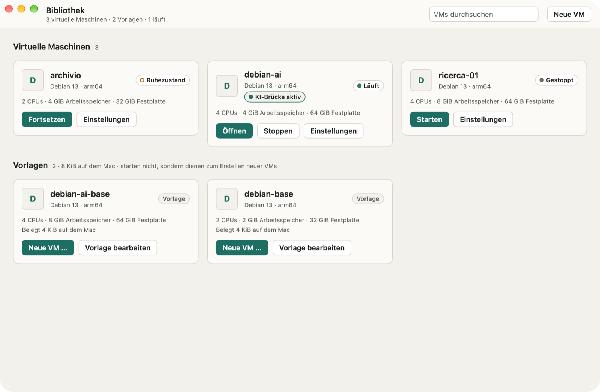
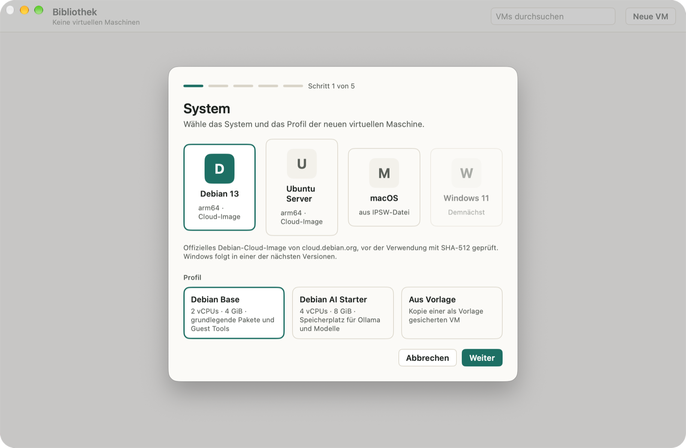
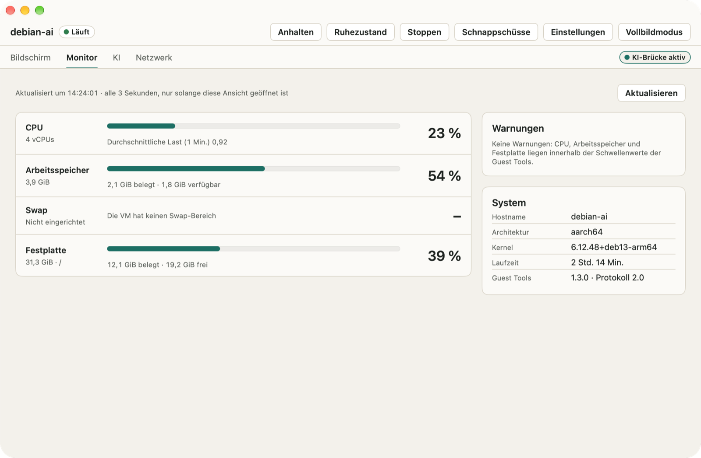
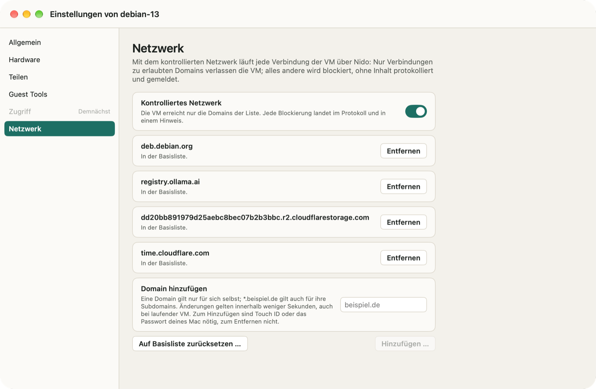
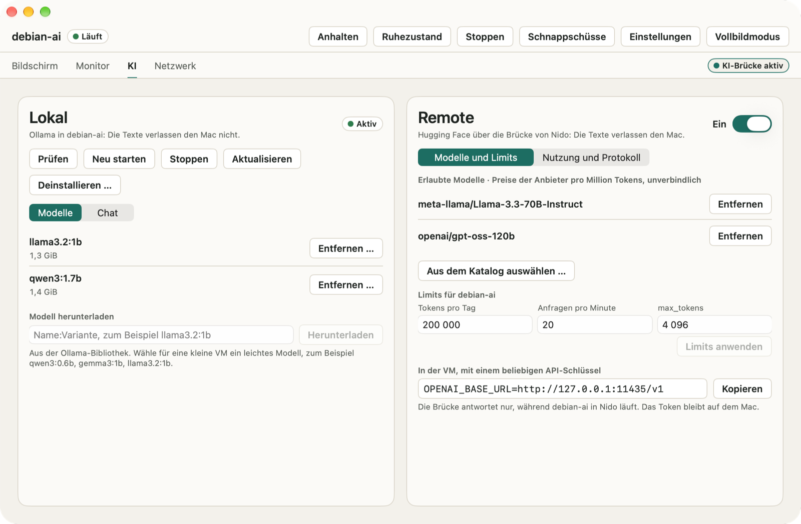

# Nido

[English](README.md) · [Italiano](README.it.md) · **Deutsch** · [Español](README.es.md) · [Français](README.fr.md)

Nido verwaltet virtuelle Maschinen auf Mac-Computern mit Apple Chip. Linux- und macOS-VMs laufen mit dem Virtualization-Framework von Apple, gesteuert über eine native App oder den Befehl `nido` im Terminal. Nido ist von Haus aus vorsichtig: Es geht nie von selbst online, eine VM erreicht nur die Domains, die du erlaubst, und sie sieht keinen Ordner deines Mac, bis du einen teilst.

<p align="center"></p>

## Was Nido kann

- **Linux-VMs aus offiziellen Cloud-Images**: Debian 13, Ubuntu Server 26.04 LTS und 24.04 LTS, jeweils für arm64. Nido lädt sie nur aus den offiziellen Quellen der Projekte herunter und prüft sie vor der Verwendung (SHA-512 bei Debian, SHA-256 und die Signatur von Ubuntu bei Ubuntu). Du kannst auch ein lokales Image verwenden, raw oder qcow2.
- **macOS-VMs aus einer IPSW-Datei**, die du bereits heruntergeladen hast. Nido liest die Datei nur: Sie wird nie heruntergeladen, geändert oder verschoben. Die Installation dauert 4 bis 20 Minuten.
- **Schnappschüsse, Ruhezustand, Klone und Vorlagen**: Kehre zu einem früheren Zustand zurück, setze eine VM im Ruhezustand genau dort fort, wo du aufgehört hast, kopiere eine gestoppte VM im Handumdrehen oder sichere sie als Vorlage für neue VMs.
- **Geteilte Ordner und Rosetta**: Teile einen Ordner deines Mac mit einer VM, nur lesbar, solange du nichts anderes wählst, und führe x86_64-Programme in Linux-VMs mit Rosetta aus.
- **Kontrolliertes Netzwerk**: Eine neue VM erreicht nur die Domains auf ihrer Liste, und Nido meldet dir jede Verbindung, die es blockiert.
- **KI in Linux-VMs**: Die Guest Tools von Nido zeigen CPU, Arbeitsspeicher und Festplatte der VM, ohne den Umweg über das Netzwerk. Installiere Ollama und ein Modell mit einem Klick und chatte in der App damit, oder verbinde eine VM über die optionale KI-Brücke mit den Inference Providers von Hugging Face.
- **In deiner Sprache**: Die App und der Befehl `nido` sprechen Englisch, Italienisch, Deutsch, Spanisch und Französisch und folgen der Sprache, die du in macOS verwendest.

## Bildschirmfotos

<p align="center">


</p>
<p align="center">


</p>

## Voraussetzungen

- Ein Mac mit Apple Chip.
- macOS 26 oder neuer.
- Speicherplatz für deine VMs. Für eine Linux-VM schlägt der Assistent „Neue VM“ eine Festplatte mit 16 GiB beim Profil Base und mit 32 GiB bei AI Starter vor (mehr, wenn das Image größer ist), und `nido create` verwendet 20 GiB; eine macOS-VM erhält 64 GiB. Du kannst eine andere Größe wählen.
- Für eine macOS-VM: ein IPSW-Wiederherstellungs-Image einer macOS-Version, die nicht neuer ist als die auf deinem Mac.

## Installation

1. Lade das DMG von der Seite „Releases“ herunter. Daneben findest du die SHA-256-Prüfsummen (`SHA256SUMS`) und die Liste der Komponenten (SBOM im SPDX-Format).
2. Öffne das DMG und ziehe Nido in den Ordner „Programme“.
3. Öffne Nido. Die App ist mit einem Developer-ID-Zertifikat signiert und von Apple notarisiert, sie öffnet sich also wie jede andere App.

Um den Download zu prüfen, lege `SHA256SUMS` in denselben Ordner wie das DMG und führe in diesem Ordner Folgendes aus:

```sh
shasum -a 256 -c SHA256SUMS --ignore-missing
```

Nido sucht nur nach Updates, wenn du es willst. Wähle **Nido › Nach Updates suchen …** oder aktiviere **Einstellungen › Allgemein › Automatisch nach Updates suchen** (Nido fragt dich danach auch beim zweiten Öffnen). Updates sind signiert und warten, bis keine VM mehr läuft. Was sich in jeder Version geändert hat, findest du unter **Hilfe › Neue Funktionen in Nido**.

## Der Befehl `nido`

Der Befehl ist in der App enthalten. Wähle **Nido › nido-Befehl installieren …**, um `~/.local/bin/nido` zu erstellen, einen Link auf den Befehl in Nido: So wird er mit der App aktualisiert. Ist `~/.local/bin` nicht in deinem `PATH`, weist Nido dich darauf hin.

Eine Linux-VM von Anfang bis Ende:

```sh
nido create dev --image debian-13 --ssh-key ~/.ssh/id_ed25519.pub
nido start dev
nido ssh dev
nido net allow dev pypi.org
nido net allow dev files.pythonhosted.org
nido list
nido stop dev
nido snapshot create dev clean
```

`nido start` hält die VM im Vordergrund (Ctrl-C stoppt sie). Führe die anderen Befehle deshalb in einem zweiten Terminal-Fenster aus. Die beiden Zeilen mit `nido net allow` erlauben `pip`, Pakete von PyPI zu installieren; jede fragt nach Touch ID oder dem Passwort deines Mac. `nido --help` listet alle Befehle auf, und `nido help <subcommand>` erklärt einen davon im Detail.

Der Befehl folgt der Sprache deines Mac. Für eine andere Sprache setze `NIDO_LANGUAGE` auf `en`, `it`, `de`, `es` oder `fr`, etwa in Skripten, die seine Ausgabe lesen.

## Datenschutz und Netzwerk

- **Nido geht nie von selbst online** und sendet keine Nutzungsdaten. Jeder Download erfolgt nur auf deinen Wunsch: ein System-Image nach deiner Bestätigung, das Archiv von Ollama, wenn du Ollama installierst, ein Update, wenn du danach suchst oder die automatische Suche aktivierst.
- **Kontrolliertes Netzwerk**: Eine neue VM erreicht nur die Domains auf ihrer Liste. Diese enthält anfangs, was das System für Pakete, Updates und die Uhrzeit braucht. Alles andere wird blockiert, auch Adressen, die nie über einen Namen aufgelöst wurden, DNS zu anderen Servern, IPv6 und die Dienste des Mac selbst. Eine Domain hinzuzufügen erfordert Touch ID oder das Passwort deines Mac, eine zu entfernen nicht. Der Tab „Netzwerk“ im Fenster der VM und `nido net log` zeigen, wohin Verbindungen gingen, nie ihren Inhalt. Das kontrollierte Netzwerk stoppt versehentlichen und naiven Datenverkehr, aber kein Gastsystem, das mit Root-Rechten entschlossen ausbrechen will: [docs/SECURITY.md](docs/SECURITY.md) erklärt die Grenzen.
- **Geteilte Ordner**: standardmäßig keine. Jeder ist nur lesbar, solange du nichts anderes wählst. Du kannst ihn jederzeit entfernen, auch während die VM in der App läuft, und Klone und Vorlagen übernehmen ihn nicht.
- **KI-Brücke**: standardmäßig in jeder VM deaktiviert. Aktivierst du sie, verlassen die Texte deinen Mac und gehen an Hugging Face und an den Anbieter, der das Modell bereitstellt. Dein Zugriffstoken bleibt im Schlüsselbund des Mac und gelangt nie in die VM. Jede VM hat eigene Limits für Tokens und Anfragen, und das Protokoll der Brücke speichert keine Inhalte. Mit Ollama bleibt der Chat in der VM und im Arbeitsspeicher der App.
- **Der Zugriff auf eine VM** erfolgt nur mit einem SSH-Schlüssel: Von Nido erstellte Linux-VMs haben kein Passwort.

Das Bedrohungsmodell und alle Sicherheitsmaßnahmen findest du in [docs/SECURITY.md](docs/SECURITY.md) (auf Englisch).

## Aus dem Quellcode bauen

Du brauchst einen Mac mit Apple Chip, macOS 26 oder neuer und Xcode mit Swift 6.2 oder neuer (getestet mit Xcode 27.2). Der Build lädt die Swift-Pakete (swift-argument-parser, Sparkle) und `gvproxy` in einer festgelegten Version herunter, die anhand ihrer SHA-256-Prüfsumme kontrolliert wird.

Führe die Tests des Befehls `nido` und seines Kerns aus und baue dann ein Debug-`nido`, ad hoc signiert mit dem Entitlement für die Virtualisierung:

```sh
scripts/fetch-gvproxy.sh
swift test
scripts/sign-dev.sh
.build/debug/nido --help
```

Baue die App als Debug und als Release:

```sh
scripts/build-app.sh
```

Die App landet in `App/build/Build/Products/Release/Nido.app`. Kopiere sie in den Ordner „Programme“ und installiere dann den Befehl mit **Nido › nido-Befehl installieren …**. Das Skript signiert die App, den darin enthaltenen Befehl `nido` und `gvproxy` ad hoc, mit Hardened Runtime, und prüft, dass `com.apple.security.virtualization` das einzige Entitlement ist: Du brauchst keinen Apple Developer Account. Um mit einer eigenen Identität zu signieren, setze `NIDO_SIGN_IDENTITY` auf ihren Namen oder ihren SHA-1-Hash im Schlüsselbund. Ein Build aus dem Quellcode hat keinen Update-Feed und sucht daher nie nach Updates.

`scripts/install.sh` erledigt alles in einem Schritt: Es baut die Release-Version, ersetzt `/Applications/Nido.app` und verlinkt `~/.local/bin/nido` mit dem Befehl. Es signiert mit einem Zertifikat vom Typ „Developer ID Application“, wenn dein Schlüsselbund eines enthält, sonst ad hoc.

## Lizenz

Nido ist freie Software unter der Apache License 2.0: siehe [LICENSE](LICENSE). Nido enthält `gvproxy` aus dem Projekt gvisor-tap-vsock (Apache-2.0), dessen Lizenz und Hinweise in der App mitgeliefert werden, und verwendet Sparkle (MIT) und swift-argument-parser (Apache-2.0).
