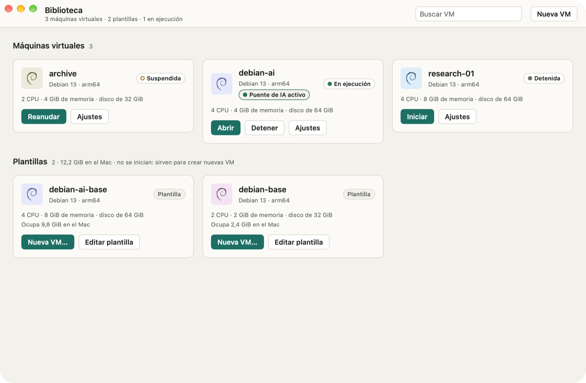
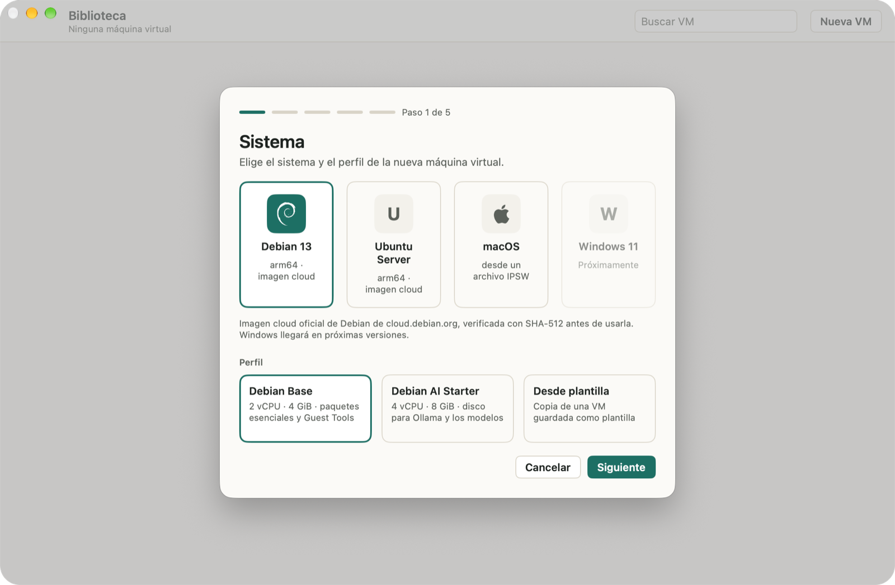
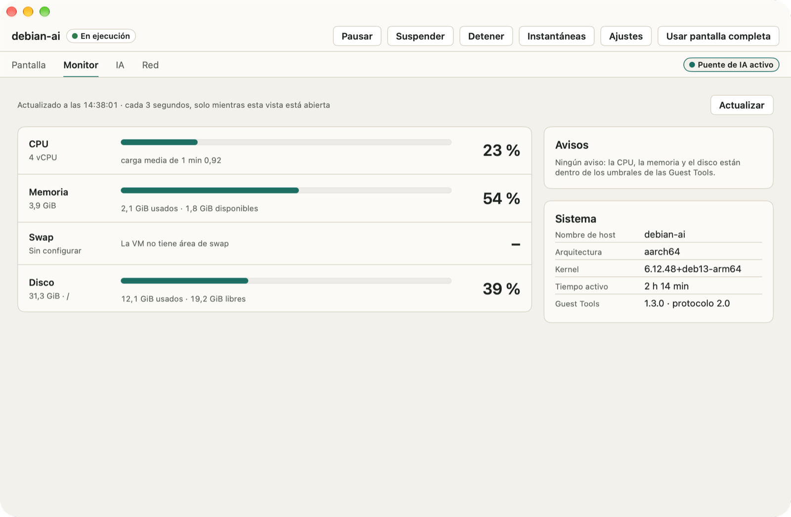
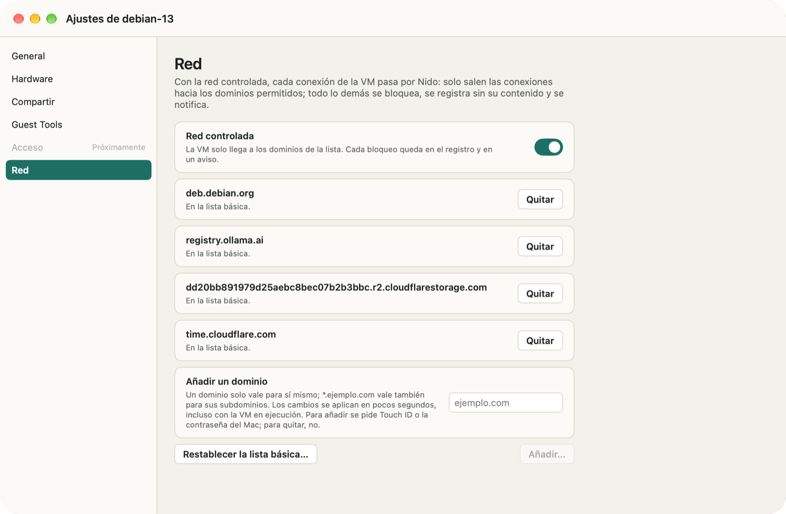
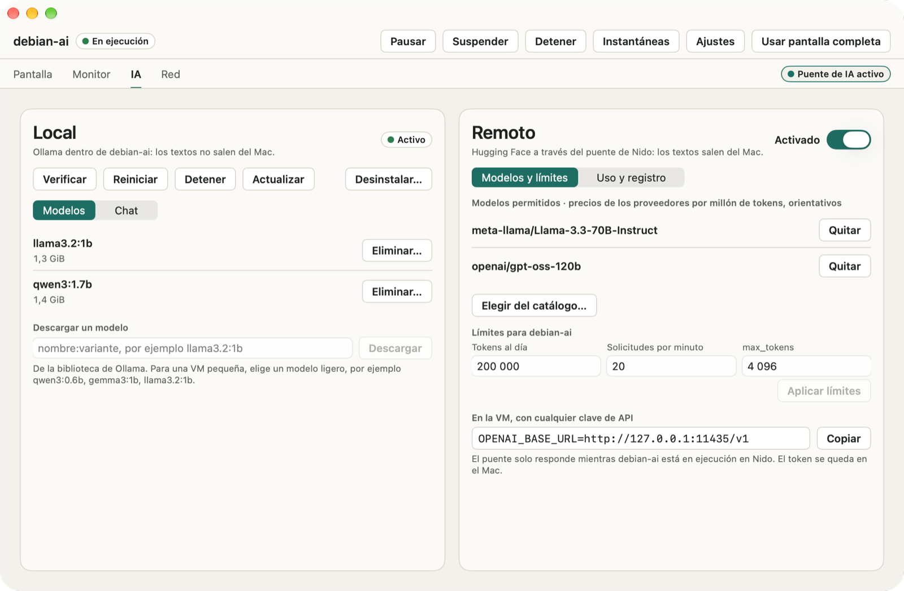

# Nido

[English](README.md) · [Italiano](README.it.md) · [Deutsch](README.de.md) · **Español** · [Français](README.fr.md)

Nido es un gestor de máquinas virtuales para Mac con chip de Apple. Ejecuta VM Linux y macOS con el framework Virtualization de Apple, desde una app nativa o con el comando `nido` en Terminal. Es prudente por omisión: Nido nunca se conecta a la red por su cuenta, una VM solo llega a los dominios que tú permites y no ve ninguna carpeta del Mac hasta que compartas una.

<p align="center"></p>

## Qué hace Nido

- **VM Linux a partir de imágenes cloud oficiales**: Debian 13, Ubuntu Server 26.04 LTS y 24.04 LTS, para arm64. Nido las descarga solo de las fuentes oficiales de cada proyecto y las verifica antes de usarlas (SHA-512 en Debian; SHA-256 y la firma de Ubuntu en Ubuntu). También puedes partir de una imagen de disco local, raw o qcow2.
- **VM macOS a partir de un archivo IPSW** que ya hayas descargado. Nido solo lee el archivo: nunca lo descarga, lo modifica ni lo mueve. La instalación tarda entre 4 y 20 minutos.
- **Instantáneas, suspensión, clones y plantillas**: vuelve a un estado anterior, reanuda una VM suspendida justo donde la dejaste, copia una VM detenida en un instante o guárdala como plantilla para crear VM nuevas.
- **Carpetas compartidas y Rosetta**: comparte una carpeta del Mac con una VM, en solo lectura salvo que elijas otra cosa, y ejecuta programas x86_64 en las VM Linux con Rosetta.
- **Red controlada**: una VM nueva solo llega a los dominios de su lista, y Nido te avisa de cada conexión que bloquea.
- **IA en las VM Linux**: las Guest Tools de Nido muestran la CPU, la memoria y el disco de la VM sin pasar por la red. Instala Ollama y un modelo con un clic y chatea con él desde la app, o conecta una VM a los Inference Providers de Hugging Face mediante el puente de IA opcional.
- **En tu idioma**: la app y el comando `nido` hablan inglés, italiano, alemán, español y francés, y siguen el idioma que usas en macOS.

## Capturas de pantalla

<p align="center">


</p>
<p align="center">


</p>

## Requisitos

- Un Mac con chip de Apple.
- macOS 26 o posterior.
- Espacio en disco para las VM. Para una VM Linux, el asistente Nueva VM propone un disco de 16 GiB con el perfil Base y de 32 GiB con AI Starter (más si la imagen es mayor), y `nido create` usa 20 GiB; una VM macOS tiene 64 GiB. Puedes elegir otro tamaño.
- Para una VM macOS: una imagen de restauración IPSW de una versión de macOS que no sea más reciente que la de tu Mac.

## Instalación

1. Descarga el DMG desde la página Releases. Junto a él se publican las sumas de control SHA-256 (`SHA256SUMS`) y la lista de componentes (SBOM, en formato SPDX).
2. Abre el DMG y arrastra Nido a la carpeta Aplicaciones.
3. Abre Nido. Está firmado con un certificado Developer ID y notarizado por Apple, así que se abre como cualquier otra app.

Para comprobar la descarga, pon `SHA256SUMS` en la misma carpeta que el DMG y ejecuta en esa carpeta:

```sh
shasum -a 256 -c SHA256SUMS --ignore-missing
```

Nido solo busca actualizaciones cuando tú se lo pides. Elige **Nido › Buscar actualizaciones…** o activa **Ajustes › General › Buscar actualizaciones automáticamente** (Nido también te lo pregunta la segunda vez que lo abres). Las actualizaciones están firmadas y esperan a que no haya ninguna VM en ejecución. Para ver qué ha cambiado en cada versión, elige **Ayuda › Novedades de Nido**.

## El comando `nido`

El comando viene incluido en la app. Elige **Nido › Instalar el comando nido…** para crear `~/.local/bin/nido`, un enlace al comando que está dentro de Nido; así se actualiza junto con la app. Si `~/.local/bin` no está en tu `PATH`, Nido te lo indica.

Una VM Linux de principio a fin:

```sh
nido create dev --image debian-13 --ssh-key ~/.ssh/id_ed25519.pub
nido start dev
nido ssh dev
nido net allow dev pypi.org
nido net allow dev files.pythonhosted.org
nido list
nido stop dev
nido snapshot create dev clean
```

`nido start` mantiene la VM en primer plano (Ctrl-C la detiene), así que ejecuta los demás comandos en una segunda ventana de Terminal. Las dos líneas `nido net allow` permiten que `pip` instale paquetes de PyPI; cada una pide Touch ID o la contraseña del Mac. `nido --help` muestra todos los comandos y `nido help <subcommand>` explica uno en detalle.

El comando usa el idioma del Mac. Para elegir otro, asigna a `NIDO_LANGUAGE` el valor `en`, `it`, `de`, `es` o `fr`, por ejemplo en scripts que leen su salida.

## Privacidad y red

- **Nido nunca se conecta a la red por su cuenta** y no envía datos de uso. Cada descarga responde a una petición tuya: una imagen del sistema después de que la confirmes, el archivo de Ollama cuando instalas Ollama, una actualización cuando la buscas o activas la búsqueda automática.
- **Red controlada**: una VM nueva solo llega a los dominios de su lista, que de entrada incluye lo que el sistema necesita para paquetes, actualizaciones y la hora. Todo lo demás se bloquea, incluidas las direcciones nunca resueltas por nombre, el DNS hacia otros servidores, IPv6 y los servicios del propio Mac. Añadir un dominio pide Touch ID o la contraseña del Mac; quitarlo, no. La pestaña Red de la ventana de la VM y `nido net log` muestran adónde fueron las conexiones, nunca lo que llevaban. La red controlada frena el tráfico accidental o ingenuo, no un sistema invitado con acceso root decidido a salir: [docs/SECURITY.md](docs/SECURITY.md) explica sus límites.
- **Carpetas compartidas**: ninguna por omisión. Cada una está en solo lectura salvo que elijas otra cosa, puedes quitarla en cualquier momento, incluso con la VM en ejecución en la app, y los clones y las plantillas no la heredan.
- **Puente de IA**: desactivado por omisión en cada VM. Cuando lo activas, los textos salen del Mac hacia Hugging Face y hacia el proveedor que sirve el modelo. Tu token de acceso se queda en el Llavero del Mac y nunca entra en la VM; cada VM tiene sus propios límites de tokens y de solicitudes, y el registro del puente no guarda ningún contenido. Con Ollama, el chat se queda en la VM y en la memoria de la app.
- **El acceso a una VM** es solo con una clave SSH: las VM Linux que crea Nido no tienen contraseña.

El modelo de amenazas y todos los controles de seguridad están en [docs/SECURITY.md](docs/SECURITY.md) (en inglés).

## Compilar desde el código fuente

Necesitas un Mac con chip de Apple, macOS 26 o posterior y Xcode con Swift 6.2 o posterior (probado con Xcode 27.2). La compilación descarga los paquetes de Swift (swift-argument-parser, Sparkle) y `gvproxy`, en una versión fija que se comprueba con su SHA-256.

Ejecuta las pruebas del comando `nido` y de su núcleo y, después, compila un `nido` de depuración, firmado ad hoc con el entitlement de virtualización:

```sh
scripts/fetch-gvproxy.sh
swift test
scripts/sign-dev.sh
.build/debug/nido --help
```

Compila la app, en Debug y en Release:

```sh
scripts/build-app.sh
```

La app queda en `App/build/Build/Products/Release/Nido.app`: cópiala a la carpeta Aplicaciones y, después, instala el comando con **Nido › Instalar el comando nido…**. El script firma ad hoc la app, el comando `nido` que lleva dentro y `gvproxy`, con Hardened Runtime, y comprueba que el único entitlement sea `com.apple.security.virtualization`: no necesitas una cuenta de desarrollador de Apple. Para firmar con una identidad propia, asigna a `NIDO_SIGN_IDENTITY` su nombre o su hash SHA-1 en el Llavero. Una compilación desde el código fuente no tiene feed de actualizaciones, así que nunca busca actualizaciones.

`scripts/install.sh` lo hace todo en un paso: compila la versión Release, sustituye `/Applications/Nido.app` y enlaza `~/.local/bin/nido` con el comando. Firma con un certificado Developer ID Application si tu Llavero tiene uno y, si no, ad hoc.

## Licencia

Nido es software libre con licencia Apache 2.0: consulta [LICENSE](LICENSE). Incluye `gvproxy` del proyecto gvisor-tap-vsock (Apache-2.0), cuya licencia y cuyo aviso van dentro de la app, y usa Sparkle (MIT) y swift-argument-parser (Apache-2.0). La espiral de las VM Debian es el [Debian Open Use Logo](https://www.debian.org/logos/) (Copyright © 1999 Software in the Public Interest, Inc., y otros; LGPL-3.0-or-later o CC-BY-SA-3.0). Apple, macOS, Debian y Ubuntu son marcas de sus respectivos titulares; Nido no está afiliado a ellos.
