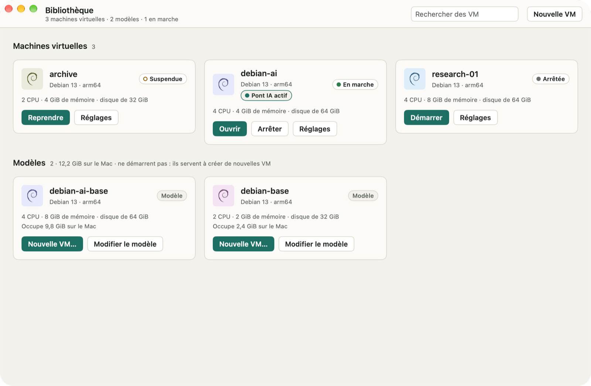
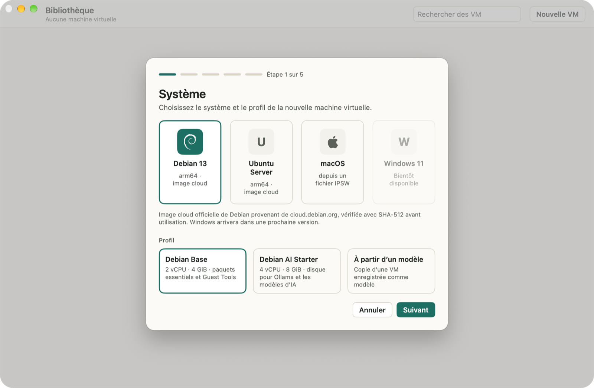
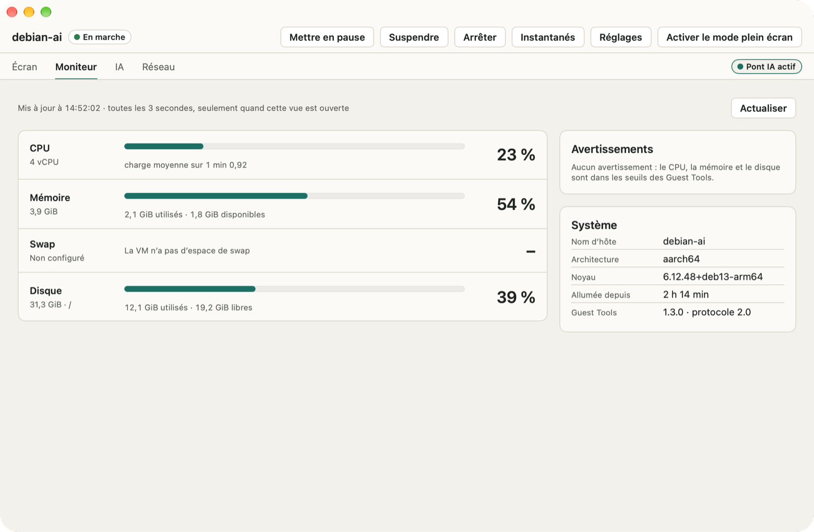
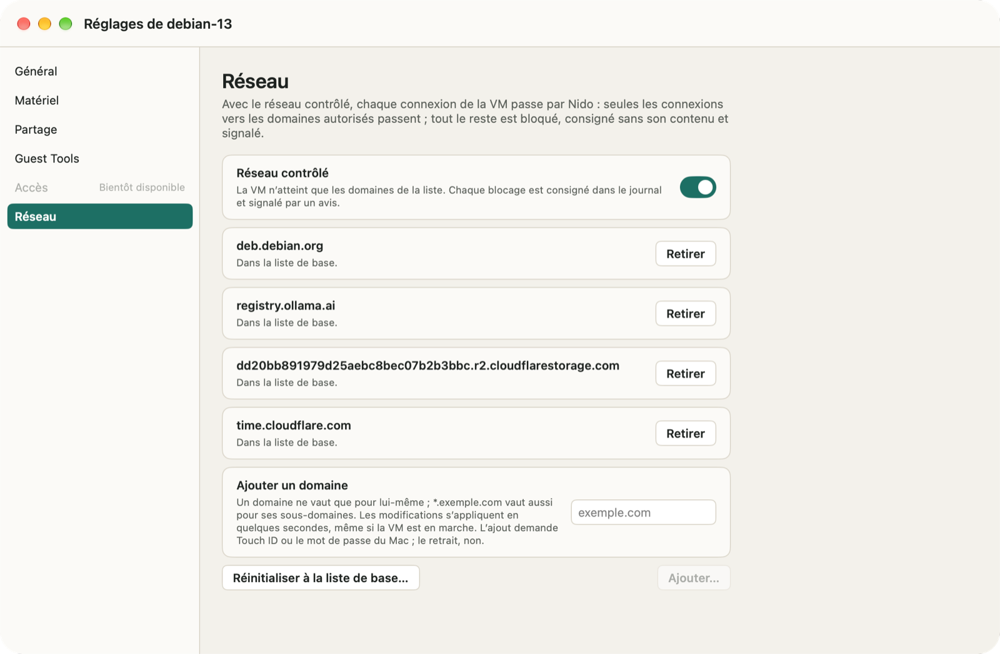
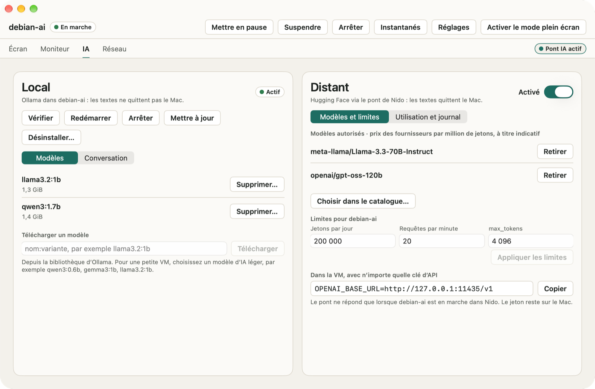

# Nido

[English](README.md) · [Italiano](README.it.md) · [Deutsch](README.de.md) · [Español](README.es.md) · **Français**

Nido est un gestionnaire de machines virtuelles pour les Mac avec puce Apple. Il fait tourner des VM Linux et macOS sur le framework Virtualization d’Apple, depuis une app native ou avec la commande `nido` dans Terminal. Il est prudent par défaut : Nido ne se connecte jamais au réseau de lui-même, une VM n’atteint que les domaines que vous autorisez, et elle ne voit aucun dossier de votre Mac tant que vous n’en avez partagé aucun.

<p align="center"></p>

## Ce que fait Nido

- **Des VM Linux à partir d’images cloud officielles** : Debian 13, Ubuntu Server 26.04 LTS et 24.04 LTS, pour arm64. Nido ne les télécharge que depuis les sources officielles des projets et les vérifie avant de s’en servir (SHA-512 pour Debian, SHA-256 et signature d’Ubuntu pour Ubuntu). Vous pouvez aussi partir d’une image disque locale, raw ou qcow2.
- **Des VM macOS à partir d’un fichier IPSW** que vous avez déjà téléchargé. Nido se contente de lire le fichier : il ne le télécharge, ne le modifie et ne le déplace jamais. L’installation prend de 4 à 20 minutes.
- **Instantanés, suspension, clones et modèles** : revenez à un état antérieur, reprenez une VM suspendue là où vous l’aviez laissée, copiez une VM arrêtée en un instant ou enregistrez-la comme modèle pour créer de nouvelles VM.
- **Dossiers partagés et Rosetta** : partagez un dossier du Mac avec une VM, en lecture seule sauf si vous en décidez autrement, et exécutez des programmes x86_64 dans les VM Linux avec Rosetta.
- **Réseau contrôlé** : une nouvelle VM n’atteint que les domaines de sa liste, et Nido vous signale chaque connexion qu’il bloque.
- **L’IA dans les VM Linux** : les Guest Tools de Nido affichent le CPU, la mémoire et le disque de la VM sans passer par le réseau. Installez Ollama et un modèle d’IA en un clic et discutez avec lui depuis l’app, ou reliez une VM aux Inference Providers de Hugging Face grâce au pont IA, facultatif.
- **Dans votre langue** : l’app et la commande `nido` parlent anglais, italien, allemand, espagnol et français, et suivent la langue que vous utilisez dans macOS.

## Captures d’écran

<p align="center">


</p>
<p align="center">


</p>

## Configuration requise

- Un Mac avec puce Apple.
- macOS 26 ou version ultérieure.
- De l’espace disque pour vos VM. Pour une VM Linux, l’assistant Nouvelle VM propose un disque de 16 GiB avec le profil Base et de 32 GiB avec AI Starter (davantage si l’image est plus grande), et `nido create` utilise 20 GiB ; une VM macOS reçoit 64 GiB. Vous pouvez choisir une autre taille.
- Pour une VM macOS : une image de restauration IPSW d’une version de macOS qui n’est pas plus récente que celle de votre Mac.

## Installation

1. Téléchargez le DMG depuis la page Releases. Les sommes de contrôle SHA-256 (`SHA256SUMS`) et la liste des composants (SBOM, au format SPDX) sont publiées à côté.
2. Ouvrez le DMG et faites glisser Nido dans le dossier Applications.
3. Ouvrez Nido. Il est signé avec un certificat Developer ID et notarié par Apple : il s’ouvre donc comme n’importe quelle autre app.

Pour vérifier le téléchargement, placez `SHA256SUMS` dans le même dossier que le DMG, puis exécutez dans ce dossier :

```sh
shasum -a 256 -c SHA256SUMS --ignore-missing
```

Nido ne recherche des mises à jour que si vous le lui demandez. Choisissez **Nido › Rechercher les mises à jour…**, ou activez **Réglages › Général › Rechercher les mises à jour automatiquement** (Nido vous le propose aussi à sa deuxième ouverture). Les mises à jour sont signées et attendent qu’aucune VM ne soit en marche. Pour découvrir les changements de chaque version, choisissez **Aide › Nouveautés de Nido**.

## La commande `nido`

La commande est fournie avec l’app. Choisissez **Nido › Installer la commande nido…** pour créer `~/.local/bin/nido`, un lien vers la commande située dans Nido : elle se met ainsi à jour avec l’app. Si `~/.local/bin` ne figure pas dans votre `PATH`, Nido vous le signale.

Une VM Linux du début à la fin :

```sh
nido create dev --image debian-13 --ssh-key ~/.ssh/id_ed25519.pub
nido start dev
nido ssh dev
nido net allow dev pypi.org
nido net allow dev files.pythonhosted.org
nido list
nido stop dev
nido snapshot create dev clean
```

`nido start` garde la VM au premier plan (Ctrl-C l’arrête) : exécutez donc les autres commandes dans une deuxième fenêtre de Terminal. Les deux lignes `nido net allow` permettent à `pip` d’installer des paquets depuis PyPI ; chacune demande Touch ID ou le mot de passe du Mac. `nido --help` liste toutes les commandes, et `nido help <subcommand>` en détaille une.

La commande suit la langue de votre Mac. Pour en choisir une autre, donnez à `NIDO_LANGUAGE` la valeur `en`, `it`, `de`, `es` ou `fr`, par exemple dans les scripts qui lisent sa sortie.

## Confidentialité et réseau

- **Nido ne se connecte jamais au réseau de lui-même** et n’envoie aucune donnée d’utilisation. Chaque téléchargement répond à une demande de votre part : une image système après votre confirmation, l’archive d’Ollama quand vous installez Ollama, une mise à jour quand vous en recherchez une ou que vous activez la recherche automatique.
- **Réseau contrôlé** : une nouvelle VM n’atteint que les domaines de sa liste, qui comprend au départ ce dont le système a besoin pour les paquets, les mises à jour et l’heure. Tout le reste est bloqué, y compris les adresses jamais résolues à partir d’un nom, le DNS vers d’autres serveurs, IPv6 et les services du Mac lui-même. Ajouter un domaine demande Touch ID ou le mot de passe du Mac ; en retirer un, non. L’onglet Réseau de la fenêtre de la VM et `nido net log` montrent où sont allées les connexions, jamais ce qu’elles transportaient. Le réseau contrôlé arrête le trafic involontaire ou naïf, pas un système invité doté des droits root et déterminé à sortir : [docs/SECURITY.md](docs/SECURITY.md) en explique les limites.
- **Dossiers partagés** : aucun par défaut. Chacun est en lecture seule sauf si vous en décidez autrement, vous pouvez le retirer à tout moment, même pendant que la VM est en marche dans l’app, et les clones et les modèles n’en héritent pas.
- **Pont IA** : désactivé par défaut dans chaque VM. Quand vous l’activez, les textes quittent le Mac vers Hugging Face et vers le fournisseur qui sert le modèle d’IA. Votre jeton d’accès reste dans le trousseau du Mac et n’entre jamais dans la VM ; chaque VM a ses propres limites de jetons et de requêtes, et le journal du pont n’enregistre aucun contenu. Avec Ollama, la conversation reste dans la VM et dans la mémoire de l’app.
- **L’accès à une VM** se fait uniquement avec une clé SSH : les VM Linux créées par Nido n’ont pas de mot de passe.

Le modèle de menaces et tous les contrôles de sécurité se trouvent dans [docs/SECURITY.md](docs/SECURITY.md) (en anglais).

## Compiler depuis les sources

Il vous faut un Mac avec puce Apple, macOS 26 ou version ultérieure et Xcode avec Swift 6.2 ou version ultérieure (testé avec Xcode 27.2). La compilation télécharge les paquets Swift (swift-argument-parser, Sparkle) et `gvproxy`, dans une version figée, contrôlée avec sa somme SHA-256.

Exécutez les tests de la commande `nido` et de son noyau, puis compilez un `nido` de débogage, signé ad hoc avec l’entitlement de virtualisation :

```sh
scripts/fetch-gvproxy.sh
swift test
scripts/sign-dev.sh
.build/debug/nido --help
```

Compilez l’app, en Debug et en Release :

```sh
scripts/build-app.sh
```

L’app se trouve ensuite dans `App/build/Build/Products/Release/Nido.app` : copiez-la dans le dossier Applications, puis installez la commande avec **Nido › Installer la commande nido…**. Le script signe ad hoc l’app, la commande `nido` qu’elle contient et `gvproxy`, avec le Hardened Runtime, et vérifie que le seul entitlement est `com.apple.security.virtualization` : aucun compte développeur Apple n’est nécessaire. Pour signer avec l’une de vos propres identités, donnez à `NIDO_SIGN_IDENTITY` son nom ou son empreinte SHA-1 dans le trousseau. Une version compilée depuis les sources n’a pas de flux de mises à jour : elle ne recherche donc jamais de mises à jour.

`scripts/install.sh` fait tout en une étape : il compile la version Release, remplace `/Applications/Nido.app` et relie `~/.local/bin/nido` à la commande. Il signe avec un certificat Developer ID Application si votre trousseau en contient un, et ad hoc sinon.

## Licence

Nido est un logiciel libre distribué sous licence Apache 2.0 : voir [LICENSE](LICENSE). Il inclut `gvproxy`, du projet gvisor-tap-vsock (Apache-2.0), dont la licence et l’avis sont fournis dans l’app, et il utilise Sparkle (MIT) et swift-argument-parser (Apache-2.0). La spirale des VM Debian est le [Debian Open Use Logo](https://www.debian.org/logos/) (Copyright © 1999 Software in the Public Interest, Inc., et autres ; LGPL-3.0-or-later ou CC-BY-SA-3.0). Apple, macOS, Debian et Ubuntu sont des marques de leurs propriétaires respectifs ; Nido n’est affilié à aucun d’eux.
