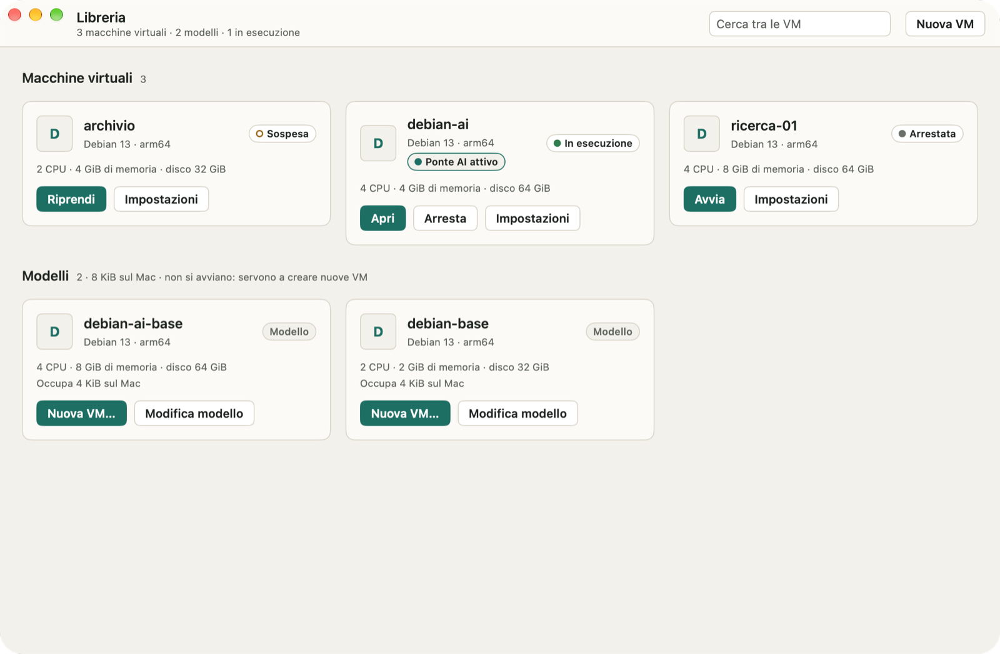
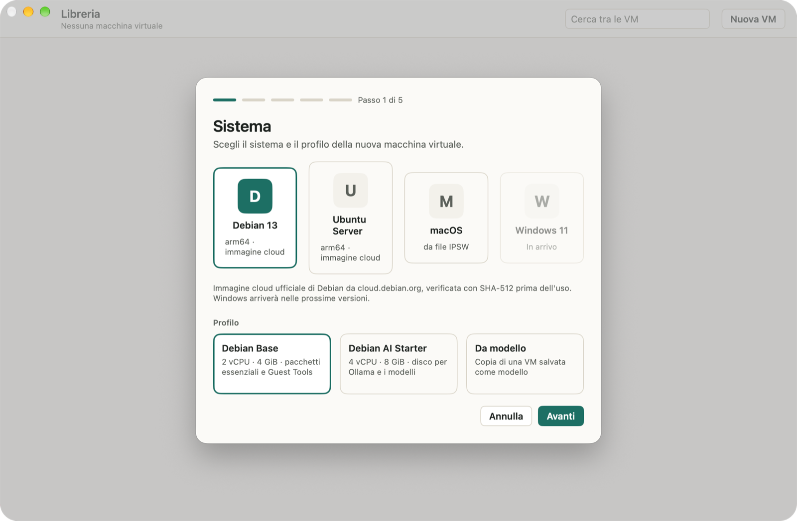
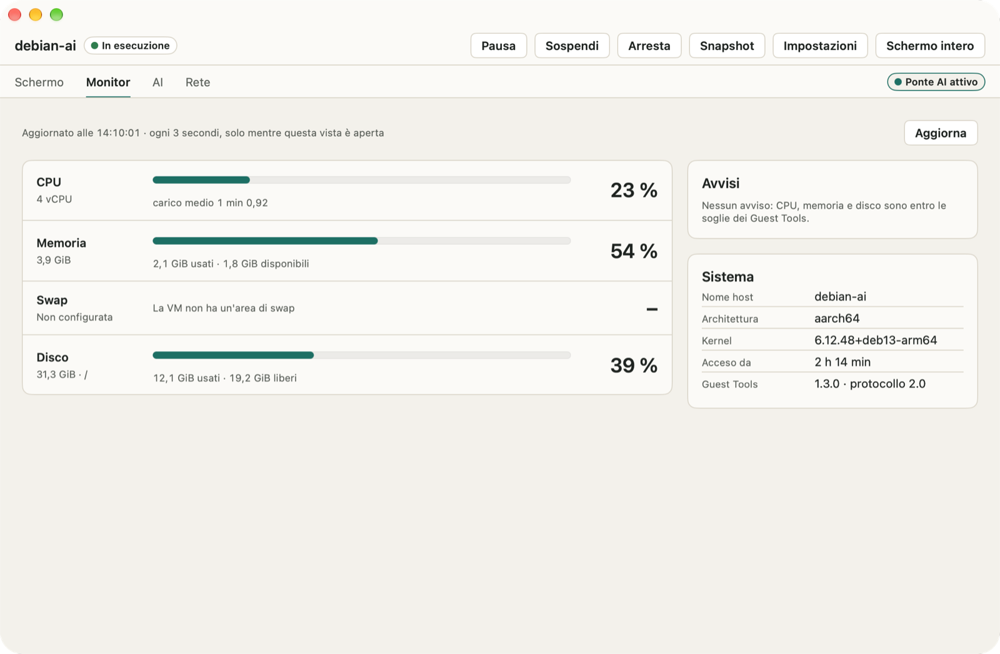
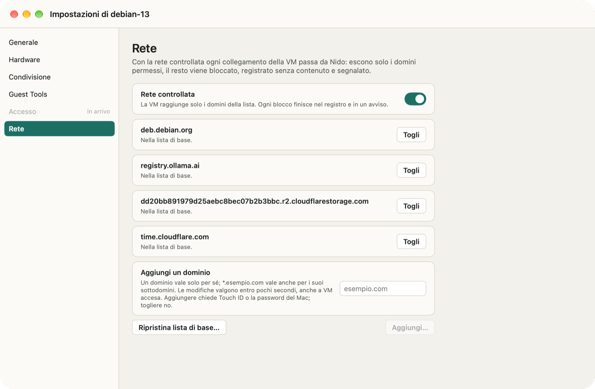
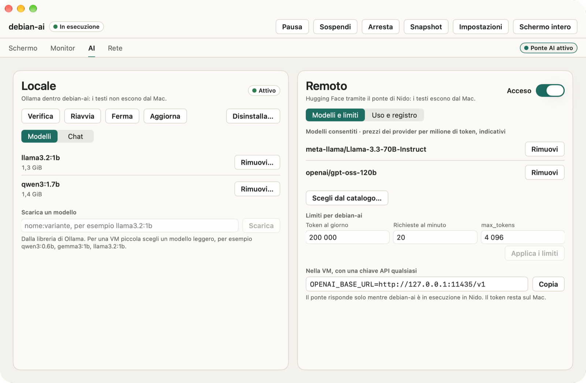

# Nido

[English](README.md) · **Italiano** · [Deutsch](README.de.md) · [Español](README.es.md) · [Français](README.fr.md)

Nido è un gestore di macchine virtuali per i Mac con chip Apple. Fa girare VM Linux e macOS con il framework Virtualization di Apple, da un'app nativa o dal comando `nido` nel Terminale. È prudente per impostazione predefinita: Nido non si collega mai alla rete da solo, una VM raggiunge solo i domini che permetti e non vede nessuna cartella del Mac finché non ne condividi una.

<p align="center"></p>

## Cosa fa Nido

- **VM Linux dalle immagini cloud ufficiali**: Debian 13, Ubuntu Server 26.04 LTS e 24.04 LTS, per arm64. Nido le scarica solo dalle fonti ufficiali dei progetti e le verifica prima di usarle (SHA-512 per Debian, SHA-256 e firma di Ubuntu per Ubuntu). Puoi anche partire da un'immagine disco locale, raw o qcow2.
- **VM macOS da un file IPSW** che hai già scaricato. Nido si limita a leggere il file: non lo scarica, non lo modifica e non lo sposta. L'installazione richiede da 4 a 20 minuti.
- **Snapshot, sospensione, cloni e modelli**: torna a uno stato precedente, riprendi una VM sospesa da dove l'avevi lasciata, copia una VM ferma in un istante o salvala come modello per creare nuove VM.
- **Cartelle condivise e Rosetta**: condividi una cartella del Mac con una VM, in sola lettura salvo scelta diversa, ed esegui i programmi x86_64 nelle VM Linux con Rosetta.
- **Rete controllata**: una VM nuova raggiunge solo i domini della sua lista, e Nido ti avvisa di ogni connessione che blocca.
- **AI nelle VM Linux**: i Guest Tools di Nido mostrano CPU, memoria e disco della VM senza passare dalla rete. Installa Ollama e un modello con un clic e chatta con il modello dall'app, oppure collega una VM agli Inference Providers di Hugging Face con il ponte AI, facoltativo.
- **Nella tua lingua**: l'app e il comando `nido` parlano inglese, italiano, tedesco, spagnolo e francese, e seguono la lingua che usi in macOS.

## Schermate

<p align="center">


</p>
<p align="center">


</p>

## Requisiti

- Un Mac con chip Apple.
- macOS 26 o successivo.
- Spazio su disco per le VM. Per una VM Linux la creazione guidata (Nuova VM) propone un disco da 16 GiB con il profilo Base e da 32 GiB con AI Starter (di più se l'immagine è più grande), mentre `nido create` usa 20 GiB; una VM macOS ha 64 GiB. Puoi scegliere un'altra dimensione.
- Per una VM macOS: un'immagine di ripristino IPSW di una versione di macOS non più recente di quella del tuo Mac.

## Installazione

1. Scarica il DMG dalla pagina Releases. Accanto ci sono i checksum SHA-256 (`SHA256SUMS`) e l'elenco dei componenti (SBOM, in formato SPDX).
2. Apri il DMG e trascina Nido nella cartella Applicazioni.
3. Apri Nido. È firmato con un certificato Developer ID e notarizzato da Apple, quindi si apre come qualunque altra app.

Per verificare il download, metti `SHA256SUMS` nella stessa cartella del DMG ed esegui in quella cartella:

```sh
shasum -a 256 -c SHA256SUMS --ignore-missing
```

Nido cerca aggiornamenti solo se glielo chiedi. Scegli **Nido › Cerca aggiornamenti…**, oppure attiva **Impostazioni › Generale › Cerca aggiornamenti automaticamente** (Nido te lo chiede anche la seconda volta che lo apri). Gli aggiornamenti sono firmati e aspettano che nessuna VM sia accesa. Per leggere le novità di ogni versione, scegli **Aiuto › Novità di Nido**.

## Il comando `nido`

Il comando è incluso nell'app. Scegli **Nido › Installa il comando nido…** per creare `~/.local/bin/nido`, un collegamento al comando dentro Nido: così si aggiorna insieme all'app. Se `~/.local/bin` non è nel tuo `PATH`, Nido te lo dice.

Una VM Linux dall'inizio alla fine:

```sh
nido create dev --image debian-13 --ssh-key ~/.ssh/id_ed25519.pub
nido start dev
nido ssh dev
nido net allow dev pypi.org
nido net allow dev files.pythonhosted.org
nido list
nido stop dev
nido snapshot create dev clean
```

`nido start` tiene la VM in primo piano (Ctrl-C la arresta), quindi esegui gli altri comandi in una seconda finestra del Terminale. Le due righe `nido net allow` permettono a `pip` di installare pacchetti da PyPI; ognuna chiede Touch ID o la password del Mac. `nido --help` elenca tutti i comandi e `nido help <subcommand>` ne spiega uno nei dettagli.

Il comando segue la lingua del Mac. Per sceglierne un'altra, imposta `NIDO_LANGUAGE` a `en`, `it`, `de`, `es` o `fr`, per esempio negli script che leggono quello che scrive.

## Privacy e rete

- **Nido non si collega mai alla rete da solo** e non invia dati d'uso. Ogni download parte da una tua richiesta: un'immagine di sistema dopo la tua conferma, l'archivio di Ollama quando installi Ollama, un aggiornamento quando lo cerchi o attivi il controllo automatico.
- **Rete controllata**: una VM nuova raggiunge solo i domini della sua lista, che parte da quello che serve al sistema per pacchetti, aggiornamenti e orologio. Tutto il resto è bloccato, compresi gli indirizzi mai cercati per nome, il DNS verso altri server, IPv6 e i servizi del Mac stesso. Aggiungere un dominio chiede Touch ID o la password del Mac; toglierlo no. La scheda Rete nella finestra della VM e `nido net log` mostrano dove sono andate le connessioni, mai cosa contenevano. La rete controllata ferma le uscite per sbaglio e quelle ingenue, non un guest con accesso root deciso a uscire: [docs/SECURITY.md](docs/SECURITY.md) ne spiega i limiti.
- **Cartelle condivise**: nessuna per impostazione predefinita. Ognuna è in sola lettura salvo scelta diversa, puoi toglierla in qualsiasi momento, anche a VM accesa nell'app, e cloni e modelli non la ereditano.
- **Ponte AI**: spento per impostazione predefinita in ogni VM. Quando lo attivi, i testi escono dal Mac verso Hugging Face e verso il provider che serve il modello. Il token di accesso resta nel Portachiavi del Mac e non entra mai nella VM; ogni VM ha i suoi limiti di token e di richieste, e il registro del ponte non contiene i testi. Con Ollama la chat resta nella VM e nella memoria dell'app.
- **L'accesso a una VM** è solo con una chiave SSH: le VM Linux create da Nido non hanno password.

Il modello di minaccia e tutti i controlli di sicurezza sono in [docs/SECURITY.md](docs/SECURITY.md) (in inglese).

## Compilare dal codice sorgente

Ti servono un Mac con chip Apple, macOS 26 o successivo e Xcode con Swift 6.2 o successivo (provato con Xcode 27.2). La build scarica i pacchetti Swift (swift-argument-parser, Sparkle) e `gvproxy`, a una versione fissata e verificata con il suo SHA-256.

Esegui i test del comando `nido` e del suo nucleo, poi compila un `nido` di debug, firmato ad hoc con l'entitlement di virtualizzazione:

```sh
scripts/fetch-gvproxy.sh
swift test
scripts/sign-dev.sh
.build/debug/nido --help
```

Compila l'app, in Debug e in Release:

```sh
scripts/build-app.sh
```

L'app finisce in `App/build/Build/Products/Release/Nido.app`: copiala nella cartella Applicazioni, poi installa il comando con **Nido › Installa il comando nido…**. Lo script firma ad hoc l'app, il comando `nido` al suo interno e `gvproxy`, con Hardened Runtime, e controlla che l'unico entitlement sia `com.apple.security.virtualization`: non ti serve un account sviluppatore Apple. Per firmare con una tua identità, imposta `NIDO_SIGN_IDENTITY` al suo nome o al suo hash SHA-1 nel Portachiavi. Una build compilata dal sorgente non ha un feed degli aggiornamenti, quindi non cerca mai aggiornamenti.

`scripts/install.sh` fa tutto in un passo: compila la Release, sostituisce `/Applications/Nido.app` e collega `~/.local/bin/nido` al comando. Firma con un certificato Developer ID Application se ce n'è uno nel tuo Portachiavi, altrimenti ad hoc.

## Licenza

Nido è software libero con licenza Apache 2.0: vedi [LICENSE](LICENSE). Include `gvproxy` del progetto gvisor-tap-vsock (Apache-2.0), la cui licenza e il cui avviso sono dentro l'app, e usa Sparkle (MIT) e swift-argument-parser (Apache-2.0).
