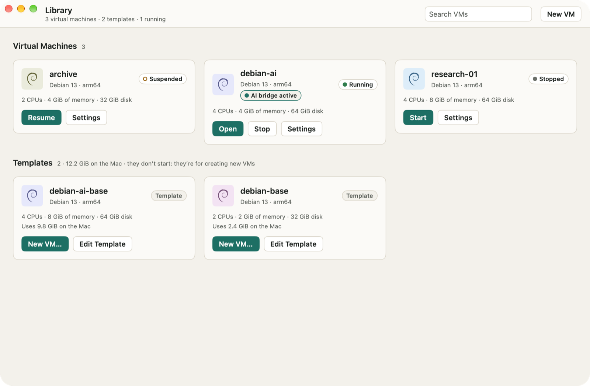
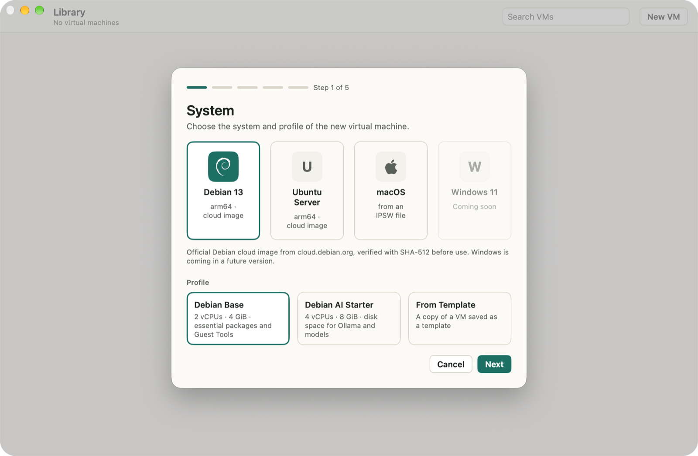
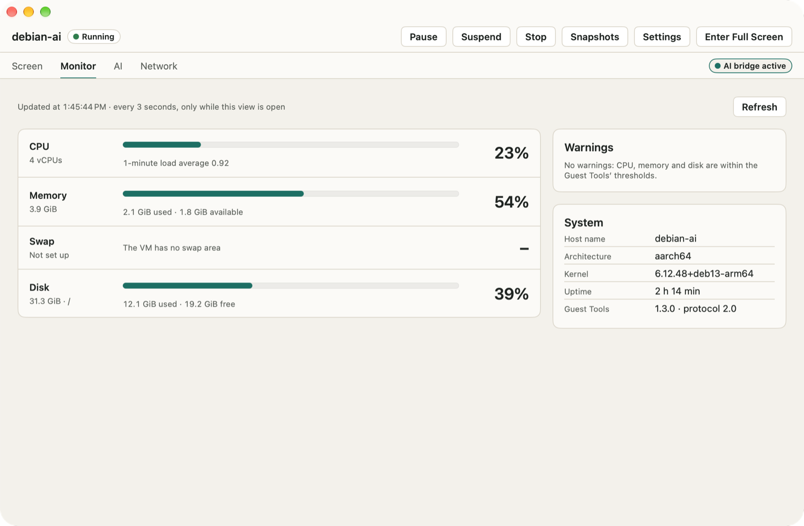
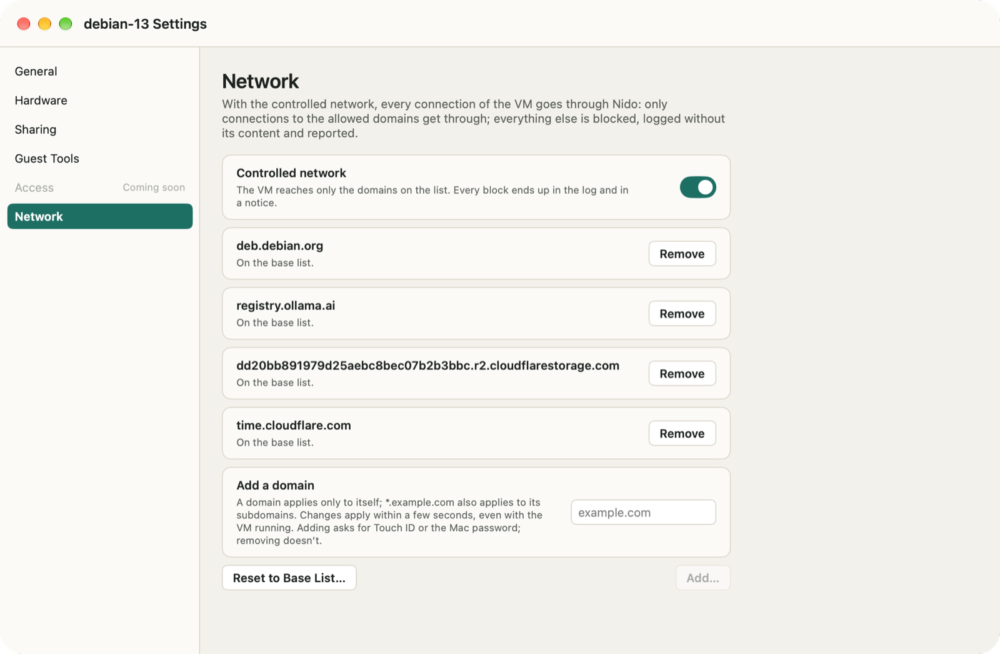
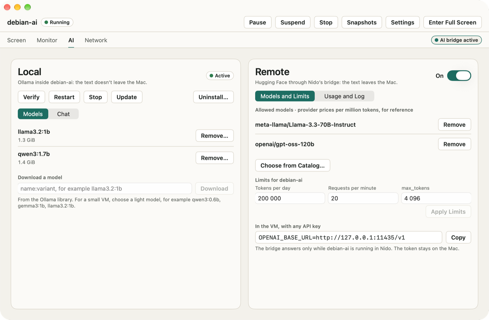

# Nido

**English** · [Italiano](README.it.md) · [Deutsch](README.de.md) · [Español](README.es.md) · [Français](README.fr.md)

Nido is a virtual machine manager for Macs with Apple silicon. It runs Linux and macOS VMs on Apple’s Virtualization framework, from a native app or from the `nido` command in Terminal. It’s careful by default: Nido never goes online on its own, a VM reaches only the domains you allow, and it sees none of your Mac’s folders until you share one.

<p align="center"></p>

## What Nido does

- **Linux VMs from official cloud images**: Debian 13, Ubuntu Server 26.04 LTS and 24.04 LTS, for arm64. Nido downloads them only from the projects’ official sources and verifies them before use (SHA-512 for Debian, SHA-256 and Ubuntu’s signature for Ubuntu). You can also start from a local disk image, raw or qcow2.
- **macOS VMs from an IPSW file** you’ve downloaded. Nido only reads the file: it never downloads, changes or moves it. Installation takes 4 to 20 minutes.
- **Snapshots, suspend, clones and templates**: go back to an earlier state, pick up a suspended VM where you left it, copy a stopped VM in an instant, or save one as a template for new VMs.
- **Shared folders and Rosetta**: share a Mac folder with a VM, read only unless you choose otherwise, and run x86_64 programs in Linux VMs with Rosetta.
- **Controlled network**: a new VM reaches only the domains on its list, and Nido tells you about every connection it blocks.
- **AI in Linux VMs**: Nido Guest Tools show the VM’s CPU, memory and disk without going through the network. Install Ollama and a model with one click and chat with it from the app, or connect a VM to Hugging Face Inference Providers through the optional AI bridge.
- **In your language**: the app and the `nido` command speak English, Italian, German, Spanish and French, and follow the language you use in macOS.

## Screenshots

<p align="center">


</p>
<p align="center">


</p>

## Requirements

- A Mac with Apple silicon.
- macOS 26 or later.
- Disk space for your VMs. For a Linux VM, the New VM wizard proposes a 16 GiB disk with the Base profile and 32 GiB with AI Starter (more if the image is larger), and `nido create` uses 20 GiB; a macOS VM gets 64 GiB. You can choose another size.
- For a macOS VM: an IPSW restore image of a macOS version no newer than the one on your Mac.

## Install

1. Download the DMG from the Releases page. The SHA-256 checksums (`SHA256SUMS`) and the list of components (SBOM, in SPDX format) are published next to it.
2. Open the DMG and drag Nido to the Applications folder.
3. Open Nido. It’s signed with a Developer ID certificate and notarized by Apple, so it opens like any other app.

To check the download, put `SHA256SUMS` in the same folder as the DMG, then run this in that folder:

```sh
shasum -a 256 -c SHA256SUMS --ignore-missing
```

Nido doesn’t check for updates unless you ask. Choose **Nido › Check for Updates…**, or turn on **Settings › General › Check for updates automatically** (Nido also asks the second time you open it). Updates are signed and wait until no VM is running. To see what changed in each version, choose **Help › What’s New in Nido**.

## The `nido` command

The command comes with the app. Choose **Nido › Install the nido Command…** to create `~/.local/bin/nido`, a link to the command inside Nido, so it’s updated along with the app. If `~/.local/bin` isn’t in your `PATH`, Nido tells you.

A Linux VM from start to finish:

```sh
nido create dev --image debian-13 --ssh-key ~/.ssh/id_ed25519.pub
nido start dev
nido ssh dev
nido net allow dev pypi.org
nido net allow dev files.pythonhosted.org
nido list
nido stop dev
nido snapshot create dev clean
```

`nido start` keeps the VM in the foreground (Ctrl-C stops it), so run the other commands in a second Terminal window. The two `nido net allow` lines let `pip` install packages from PyPI; each one asks for Touch ID or your Mac password. `nido --help` lists every command, and `nido help <subcommand>` explains one in detail.

The command follows your Mac’s language. To choose another one, set `NIDO_LANGUAGE` to `en`, `it`, `de`, `es` or `fr`, for example in scripts that read its output.

## Privacy and the network

- **Nido never goes online on its own** and sends no usage data. Every download is one you asked for: a system image after you confirm it, the Ollama archive when you install Ollama, an update when you check for one or turn on automatic checks.
- **Controlled network**: a new VM reaches only the domains on its list, which starts with what the system needs for packages, updates and the clock. Everything else is blocked, including addresses never looked up by name, DNS to other servers, IPv6 and the Mac’s own services. Adding a domain asks for Touch ID or your Mac password; removing one doesn’t. The Network tab in the VM window and `nido net log` show where connections went, never what they carried. The controlled network stops accidental and careless traffic, not a guest with root access that’s determined to get out: [docs/SECURITY.md](docs/SECURITY.md) explains the limits.
- **Shared folders**: none by default. Each one is read only unless you choose otherwise, you can remove it at any time, even while the VM is running in the app, and clones and templates don’t inherit it.
- **AI bridge**: off by default for every VM. When you turn it on, prompts and replies leave your Mac for Hugging Face and the provider that serves the model. Your access token stays in the Mac’s Keychain and never enters the VM; each VM has its own token and request limits, and the bridge’s log records no content. With Ollama, the chat stays in the VM and in the app’s memory.
- **Access to a VM** is with an SSH key only: Linux VMs created by Nido have no password.

The threat model and every security control are in [docs/SECURITY.md](docs/SECURITY.md).

## Building from source

You need a Mac with Apple silicon, macOS 26 or later and Xcode with Swift 6.2 or later (tested with Xcode 27.2). The build downloads the Swift packages (swift-argument-parser, Sparkle) and `gvproxy`, at a pinned version that’s checked against its SHA-256.

Run the tests of the `nido` command and its core, then build a debug `nido`, signed ad hoc with the virtualization entitlement:

```sh
scripts/fetch-gvproxy.sh
swift test
scripts/sign-dev.sh
.build/debug/nido --help
```

Build the app, in Debug and Release:

```sh
scripts/build-app.sh
```

The app ends up in `App/build/Build/Products/Release/Nido.app`; copy it to the Applications folder, then install the command with **Nido › Install the nido Command…**. The script signs the app, the `nido` command inside it and `gvproxy` ad hoc, with the Hardened Runtime, and checks that the only entitlement is `com.apple.security.virtualization`: you don’t need an Apple developer account. To sign with one of your own identities, set `NIDO_SIGN_IDENTITY` to its name or SHA-1 hash in the keychain. A build from source has no update feed, so it never checks for updates.

`scripts/install.sh` does it all in one step: it builds Release, replaces `/Applications/Nido.app` and links `~/.local/bin/nido` to the command. It signs with a Developer ID Application certificate if your keychain has one, and ad hoc otherwise.

## License

Nido is free software under the Apache License 2.0: see [LICENSE](LICENSE). It includes `gvproxy` from the gvisor-tap-vsock project (Apache-2.0), whose license and notice ship inside the app, and it uses Sparkle (MIT) and swift-argument-parser (Apache-2.0). The Debian swirl on Debian VMs is the [Debian Open Use Logo](https://www.debian.org/logos/) (Copyright © 1999 Software in the Public Interest, Inc., and others; LGPL-3.0-or-later or CC-BY-SA-3.0). Apple, macOS, Debian and Ubuntu are trademarks of their owners; Nido isn’t affiliated with them.
